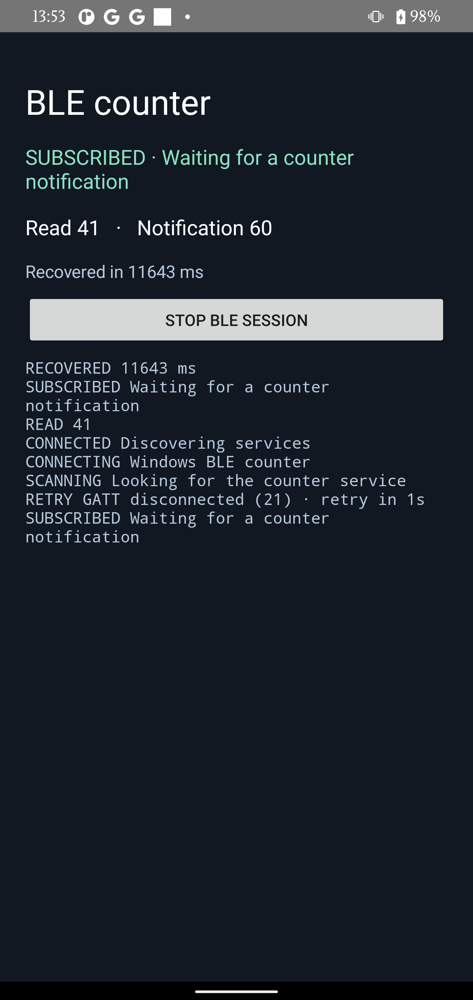

# BLE test evidence

## Automated checks

- Three JVM tests cover retry backoff, timing the first notification after resubscription, and initial connection retries.
- Six AAB preflight tests pass on the updated Kotlin example.

## Hardware results

The same debug APK (SHA-256 `b7b4eedc3bf4a364e2975c6bbf90ab986654b2ffe51ffa59ccb5755a071b85aa`) and Windows counter script were used with both Android devices.

### Pixel 4 XL · Android 11 (API 30)

The app read counter 2, subscribed, and received updates through counter 29. The Windows script switched off Bluetooth for 8 seconds and resumed advertising. The app automatically reconnected, read counter 41, restored the subscription, and received notification 41. The app recorded **11,643 ms** from detecting the disconnect to receiving that notification. Updates continued after recovery.



```text
13:52:42.382 NOTIFY 29
13:52:43.475 RETRY GATT disconnected (21)
13:52:53.101 CONNECTED Discovering services
13:52:54.422 READ 41
13:52:54.444 SUBSCRIBED Waiting for a counter notification
13:52:55.116 NOTIFY 41
13:52:55.118 RECOVERED 11643 ms
```

### Kalama · Android 15 (API 35)

Kalama for arm64 ran Android 15 (API 35). The Windows host ran Windows 11 25H2 (build 26200) with an Intel Wireless Bluetooth adapter (driver 23.120.0.4).

| Step | Observed result |
| --- | --- |
| Install and open the debug APK | Passed |
| Windows advertises the GATT counter | Passed |
| Android scans and finds the service | Passed |
| Android establishes the BLE link | Failed before service discovery. GATT returned status 133 and the Android stack logged `HCI_ERR_CONN_FAILED_ESTABLISHMENT`. |
| Windows radio off/on and advertising resume | Passed. The original Windows radio state was restored after the run. |
| Read, notify, and receive a fresh notification after reconnection | Pending a stable link. Recovery time is unavailable. |

The final run recorded seven connection attempts and seven status-133 failures, including attempts after the Windows radio came back on. Restarting Bluetooth on Kalama in a separate run reproduced the same connection failure. These runs isolate the failure to connection establishment on this device pair. The specific cause is still open.

[Android screen during the connection attempts](images/ble-kalama-connection.png)

Excerpt from the app log:

```text
05:03:18.640 CONNECTING Windows BLE counter
05:03:18.908 RETRY GATT disconnected (133) · retry in 1s
05:03:23.349 CONNECTING Windows BLE counter
05:03:23.630 RETRY GATT disconnected (133) · retry in 2s
05:03:46.109 CONNECTING Windows BLE counter
05:03:46.368 RETRY GATT disconnected (133) · retry in 4s
```
